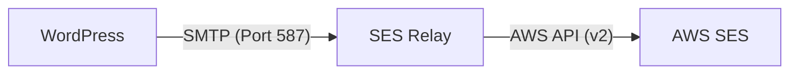
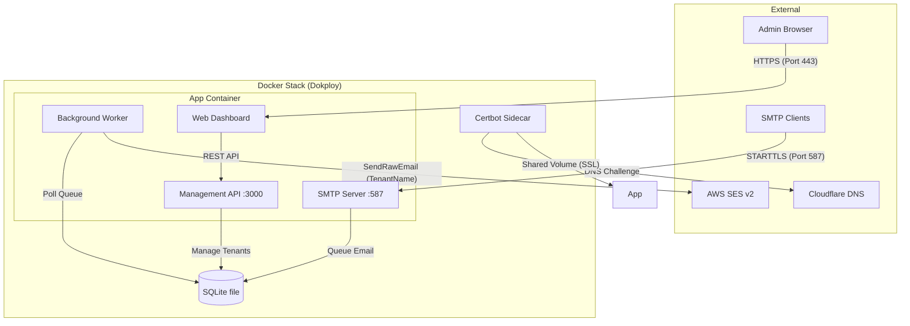

# SES Relay

SMTP Relay with AWS SES Tenant Tagging & Queuing.

## Features
- **SMTP Relay**: Authenticates users against a local SQLite database (single file, no DB server).
- **Queuing**: Emails are stored in a `mail_queue` table before being sent to AWS SES.
- **Tenant Routing**: Automatically routes emails through AWS SES `TenantName` context.
- **Management UI**: Secure dashboard to manage tenants, limits, and configuration sets.
- **Reliability**: Atomic locking, exponential backoff retries, and automatic queue cleanup.
- **Security**: Forced STARTTLS on port 587, API key protection, and rate limiting.
- **Dockerized**: Fully containerized with `docker-compose`.

## Use Case: Multi-Tenant Hosting

This project is ideal for SaaS providers or agencies hosting multiple clients who need to send emails via AWS SES.

- **Isolation**: Each client gets their own SMTP username and password.
- **Automatic Tagging**: When a client sends an email, the relay automatically maps their credentials to their specific **Tenant ID** (via `TenantName` and `X-Tenant-ID` header).
- **Zero Configuration for Clients**: Clients don't need to know about AWS, IAM keys, or Tenant IDs. They just use standard SMTP credentials.
- **Credential Security**: Your master AWS IAM keys and main SMTP settings are never exposed to your clients.
- **Control**: You can pause sending or set daily limits for specific clients without affecting others.

## Prerequisites
- **AWS Account**: IAM user with `AmazonSESFullAccess` (or specific `ses:SendRawEmail` permissions).
- **Cloudflare Account**: For automatic Let's Encrypt DNS challenge.
- **Dokploy**: Or any Docker-compatible hosting environment.

## Configuration

| Variable | Description | Default | Required |
|----------|-------------|---------|----------|
| `AWS_ACCESS_KEY_ID` | Standard IAM Access Key (NOT SMTP) | - | Yes |
| `AWS_SECRET_ACCESS_KEY` | Standard IAM Secret Key (NOT SMTP) | - | Yes |
| `AWS_REGION` | AWS Region (e.g., `ap-southeast-1`) | `ap-southeast-1` | Yes |
| `ADMIN_API_KEY` | Key to protect the Management UI/API | - | Yes |
| `CLOUDFLARE_API_TOKEN` | Cloudflare Token (Zone:DNS:Edit) | - | Yes |
| `SMTP_DOMAIN` | Your relay domain (e.g., `relay.example.com`) | - | Yes |
| `DB_PATH` | SQLite database file | `/data/relay.db` | No |
| `QUEUE_POLL_MS` | Queue poll interval in ms | `10000` | No |
| `QUEUE_BATCH_SIZE` | Emails claimed per poll cycle | `10` | No |
| `SES_GUARD` | `reject` answers 550 at SMTP time when the From domain is not a verified SES identity, or the tenant's configuration set does not exist; `off` disables | `reject` | No |
| `SES_GUARD_TTL_MS` | How long the verified-identity/config-set cache is trusted | `600000` | No |
| `CERT_CHECK_MS` | How often the cert files are checked for renewal (a change restarts the process to load them) | `60000` | No |

## Deployment on Dokploy

1.  **Create a new Project** in Dokploy.
2.  **Add a Compose Service** and point it to this repository.
3.  **Configure Environment Variables** in the Dokploy UI (see table above).
4.  **Expose Ports**:
    - Dokploy handles port `3000` (Web UI) automatically via Traefik.
    - **Manually expose port `587`** in Dokploy settings for SMTP traffic.
5.  **Deploy**: The application creates the SQLite schema on first start. The database lives on the `relay_data` volume — back that volume up, that file is the whole state.

## Usage

### Web Interface
Access the dashboard at `http://your-domain.com` (or the Dokploy URL).
1.  **Login**: Enter your `ADMIN_API_KEY`.
2.  **Stats**: Monitor the queue status (Pending, Processing, Sent, Failed) in real-time.
3.  **Tenants**: Create tenants with specific **AWS Configuration Sets** and **Daily Limits**.

### SMTP Relay
Connect your SMTP client to `your-domain.com:587`.
- **Security**: STARTTLS is **mandatory**. Plaintext connections are rejected.
- **Authentication**: Use the `smtp_username` and `smtp_password` generated in the UI.
- **Visibility**: Every email sent through the relay will include an `X-Tenant-ID` header containing the tenant's tag for easy identification in the message source.

#### Client Configuration (msmtp)
```conf
host relay.example.com
port 587
tls on
tls_starttls on
tls_certcheck on
auth on
user your_smtp_username
password your_smtp_password
```
*Note: `auth on` is secure here because the connection is encrypted via STARTTLS before authentication occurs.*

## API Reference

All API requests (except `/api/health`) require the `X-API-Key` header.

| Endpoint | Method | Description |
|----------|--------|-------------|
| `/api/tenants` | GET | List all tenants |
| `/api/tenants` | POST | Create a new tenant |
| `/api/tenants/:id` | PUT | Update an existing tenant |
| `/api/stats` | GET | Get real-time queue statistics |
| `/api/health` | GET | Service health check (Public) |
| `/api/verify` | GET | Verify Admin API Key |

## Troubleshooting: "Email address is not verified"

SES is in production mode (any recipient is allowed), so this error always means the
**From domain is not a verified identity in that region**. It used to appear only in
`mail_queue.error_message` after the client already got a `250`; `SES_GUARD=reject`
now refuses the message at DATA time with a permanent `550` naming the domain, so the
sending application sees the real cause immediately.

Two ways to resolve it:
1. Verify the domain in SES (console → Verified identities → add the domain, add the
   DKIM CNAMEs it gives you), or
2. Change the application's `MAIL_FROM`/`From` to a domain already verified in that
   region (`aws sesv2 list-email-identities`).

The relay does not rewrite From addresses: a sender that lies about its From is a
misconfigured sender, and silently rewriting it breaks reply handling.

## AWS SES Setup
To ensure emails are delivered correctly:
1.  **Verify Domain**: Your `SMTP_DOMAIN` (or the domain used in `From` addresses) must be verified in the AWS SES Console.
2.  **Configuration Sets**: If you assign a Configuration Set to a tenant, ensure it exists in the **same AWS Region** as your relay.
3.  **Permissions**: The IAM user must have `ses:SendRawEmail` and `ses:GetSendQuota` permissions.

## Let's Encrypt Integration (Cloudflare DNS)

The project uses a Certbot sidecar with the Cloudflare DNS challenge. This allows SSL generation even if your server is behind a firewall or Cloudflare Proxy.

### 1. Initial Setup (One-time)
Run this command from your server's compose directory:
```bash
cd /etc/dokploy/compose/<your-service-id>/code
docker compose run --rm certbot -c "
  echo 'dns_cloudflare_api_token = \$CLOUDFLARE_API_TOKEN' > /etc/letsencrypt/cloudflare.ini && 
  chmod 600 /etc/letsencrypt/cloudflare.ini && 
  certbot certonly --dns-cloudflare --dns-cloudflare-credentials /etc/letsencrypt/cloudflare.ini --dns-cloudflare-propagation-seconds 60 --email your-email@example.com --agree-tos --no-eff-email -d relay.example.com
"
```

### 2. Automatic Renewal
The `certbot` container checks for renewals every 12 hours. The `app` container will pick up new certificates upon restart.

## Operations & Maintenance

### Monitoring Logs
```bash
docker compose logs -f app     # Application & Worker logs
docker compose logs -f certbot # SSL renewal logs
docker compose exec app ls -l /data   # SQLite file + WAL
```

### Queue Management
- **Retries**: Failed emails are retried 3 times with exponential backoff.
- **Cleanup**: Sent emails are deleted after 7 days; failures that exhausted retries after 30 days.
- **Backup**: `docker run --rm -v <stack>_relay_data:/d -v $PWD:/b alpine tar czf /b/relay-db.tgz -C /d .` — stop the app first (or use `sqlite3 relay.db '.backup'`).

## How it Works (Simplified)



## Architecture



- **Node.js (TypeScript)**: Core logic and SMTP server.

## Resource footprint

The stack is two containers (app + certbot sidecar) and no database server:

| | v1 (MariaDB) | v2 (SQLite) |
|---|---|---|
| Containers | 3 | 2 |
| RAM (idle, measured) | ~51 MiB | ~27 MiB |
| Images | ~836 MB | ~378 MB |
| Data on disk | 162 MB volume | ~100 KB file |

Runtime dependencies: `express`, `smtp-server`, `@aws-sdk/client-sesv2`. Password
hashing uses `node:crypto` scrypt and storage uses the built-in `node:sqlite`, so
there is no native module to compile.

## Migrating an existing MariaDB deployment (v1 -> v2)

Tenants are the only state worth carrying over; queued mail does not survive a relay
restart anyway. Seed the SQLite volume **before** the container starts:

```bash
STACK=aws-and-tools-aws-ses-relay-yplxvu   # compose appName
docker volume create ${STACK}_relay_data

# export tenants from the running MariaDB
docker exec ${STACK}-db-1 sh -c 'mariadb -u"$DB_USER" -p"$DB_PASSWORD" "$DB_NAME" -N -B \
  -e "select id,name,smtp_username,smtp_password,tenant_tag,ifnull(configuration_set,\"\"),daily_limit from tenants"' \
  | docker run --rm -i -v ${STACK}_relay_data:/data -v "$PWD/scripts":/scripts:ro \
      --entrypoint node node:24-alpine /scripts/migrate-from-mariadb.mjs /data/relay.db
```

The migration script recomputes password hashes with scrypt from the plaintext
`smtp_password` column, so existing SMTP clients keep working without new credentials.
Deploy after seeding, then drop the old `${STACK}_db_data` volume once `/api/tenants`
returns the expected rows.

