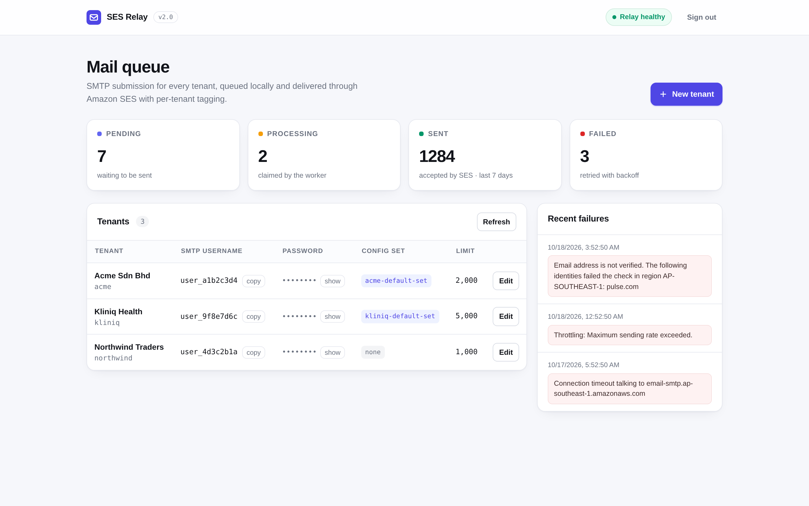
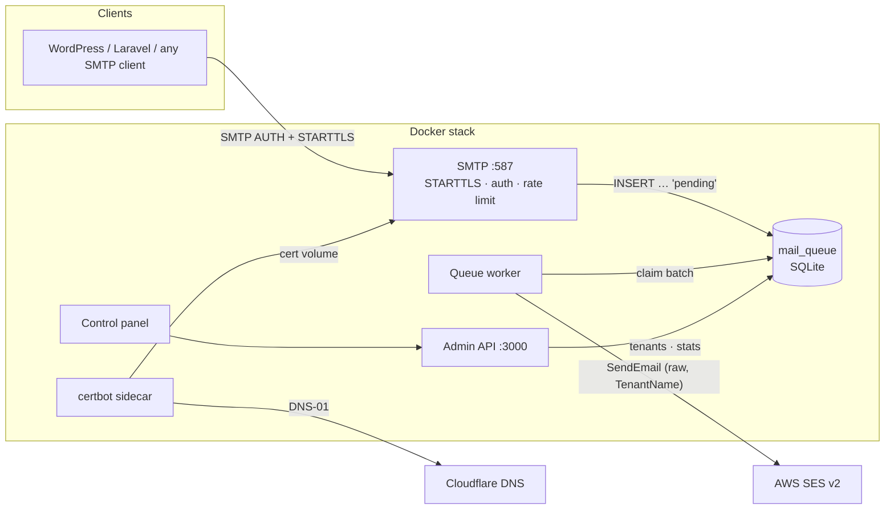
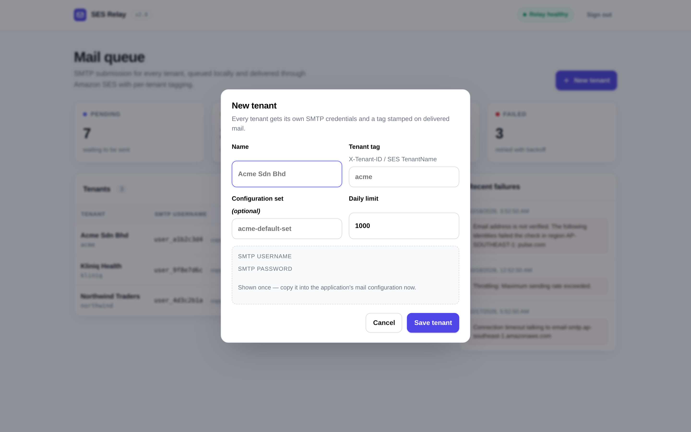
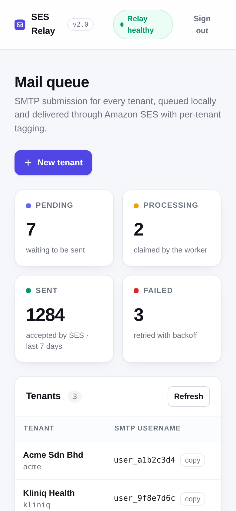

<div align="center">

# SES Relay

**A small, self-hosted, multi-tenant SMTP relay for Amazon SES.**
One SMTP endpoint for every client. Per-tenant credentials, tagging, rate limits and a queue — in a single container with no database server.

[](LICENSE)
[](package.json)
[](docker-compose.yml)



</div>

---

## Why this exists

Giving clients SMTP credentials usually means either handing out your master SES
keys, or standing up one mail service per client. This relay sits in the middle:
each client authenticates with its own username/password on port 587, mail is
queued locally, and the worker delivers it through SES with the client's
`TenantName` and an `X-Tenant-ID` header. The AWS credentials never leave the
server.

It is deliberately small: ~500 lines of TypeScript, three runtime dependencies,
one SQLite file, and a memory footprint around 25 MiB.

## Features

| | |
|---|---|
| **Multi-tenant SMTP** | STARTTLS on 587, PLAIN/LOGIN auth against per-tenant credentials |
| **Per-tenant tagging** | SES `TenantName` plus an `X-Tenant-ID` header on every message |
| **Durable queue** | Messages are committed to SQLite before the client gets its `250` |
| **Backoff retries** | 3 attempts with growing delay; failures recorded with the real SES error |
| **Daily limits** | Per-tenant cap, enforced at submission time |
| **Pre-flight guard** | Answers `550` when the From domain is not a verified SES identity, or the configuration set does not exist — instead of queueing mail that is certain to fail |
| **Control panel** | Zero-dependency web UI for queue health, tenants and recent failures |
| **Certificate handling** | certbot sidecar with Cloudflare DNS-01, self-reload when the certificate changes |
| **Tiny footprint** | One app container + one certbot sidecar, no RDBMS, non-root, memory-capped |

## Architecture



**Queue lifecycle:** `pending → processing → sent`, or `failed` with `retries`
incremented and `next_retry_at` set. A batch is claimed inside a single
`BEGIN IMMEDIATE` transaction, so a second worker instance can never send the
same message twice. Sent rows are deleted after 7 days, exhausted failures after 30.

## Quick start

```bash
git clone https://github.com/wzul/project-ses-relay.git
cd project-ses-relay
cp .env.example .env      # fill in AWS keys, ADMIN_API_KEY, SMTP_DOMAIN
docker compose up -d --build
```

Open `http://localhost:3000`, paste your `ADMIN_API_KEY`, create a tenant, and
point any SMTP client at `your-domain:587`.

<details>
<summary>Client configuration (msmtp, Laravel, WordPress)</summary>

**msmtp**

```conf
host mailerrelay.example.com
port 587
tls on
tls_starttls on
tls_certcheck on
auth on
user user_xxxxxxxx
password your_generated_password
```

**Laravel / Symfony Mailer**

```dotenv
MAIL_MAILER=smtp
MAIL_HOST=mailerrelay.example.com
MAIL_PORT=587
MAIL_USERNAME=user_xxxxxxxx
MAIL_PASSWORD=your_generated_password
MAIL_ENCRYPTION=tls
MAIL_FROM_ADDRESS=noreply@your-verified-domain.com
```
</details>

> `MAIL_FROM_ADDRESS` matters: the relay does **not** rewrite `From`. It must be on
> a domain verified in SES (see [Troubleshooting](#troubleshooting)).

## Screenshots

<div align="center">




</div>

## Configuration

| Variable | Description | Default |
|---|---|---|
| `AWS_ACCESS_KEY_ID` / `AWS_SECRET_ACCESS_KEY` | IAM user with `ses:SendEmail`, `ses:SendRawEmail`, `ses:ListEmailIdentities`, `ses:ListConfigurationSets` | — |
| `AWS_REGION` | Region of your SES identities | `ap-southeast-1` |
| `ADMIN_API_KEY` | Protects `/api/*` and the control panel | — |
| `SMTP_DOMAIN` | Hostname whose Let's Encrypt certificate is used for STARTTLS | — |
| `CLOUDFLARE_API_TOKEN` | DNS-01 token for the certbot sidecar (`Zone:DNS:Edit`) | — |
| `SMTP_PORT` / `API_PORT` | Listen ports | `587` / `3000` |
| `DB_PATH` | SQLite file | `/data/relay.db` |
| `QUEUE_POLL_MS` | Queue poll interval | `10000` |
| `QUEUE_BATCH_SIZE` | Messages claimed per poll | `10` |
| `SES_GUARD` | `reject` = 550 on unverified From domain / unknown configuration set, `off` = never pre-check | `reject` |
| `SES_GUARD_TTL_MS` | How long the verified-identity cache is trusted | `600000` |
| `CERT_CHECK_MS` | Certificate mtime poll (a change restarts the process) | `60000` |
| `MARIADB_*`, `DB_HOST`, `DB_USER` … | **Removed in v2** — ignored if still present | — |

The database is a single file on the `relay_data` volume: back that up and you have
backed up the relay.

## API

All routes except `/api/health` require `X-API-Key: $ADMIN_API_KEY`.

| Method | Route | Description |
|---|---|---|
| `GET` | `/api/health` | Liveness + database check (public, used by the container healthcheck) |
| `GET` | `/api/verify` | Validate the admin key |
| `GET` | `/api/stats` | Queue counts per status + last 5 failures |
| `GET` | `/api/tenants` | List tenants |
| `POST` | `/api/tenants` | Create a tenant (returns the SMTP password **once**) |
| `PUT` | `/api/tenants/:id` | Update name, tag, configuration set, daily limit |

```bash
curl -s -H "X-API-Key: $ADMIN_API_KEY" https://relay.example.com/api/stats
# {"counts":{"sent":1284,"failed":3},"recent_errors":[...]}
```

## Operations

**Logs**

```bash
docker compose logs -f app      # SMTP, worker, guard decisions
docker compose logs -f certbot  # renewals
```

**Backup / restore** (stop the app first, or use `sqlite3 .backup`)

```bash
docker run --rm -v <stack>_relay_data:/d -v "$PWD":/b alpine tar czf /b/relay-db.tgz -C /d .
```

**Certificates.** The sidecar renews with a Cloudflare DNS-01 challenge every 12
hours and relaxes the key to group `101` so the non-root app can read it. The app
watches the certificate files and restarts itself when they change, so a renewal is
served without a manual restart.

**Health.** `GET /api/health` is wired into the container healthcheck; `/api/stats`
drives the KPI cards.

## Troubleshooting

**`Email address is not verified. The following identities failed the check in region …`**

The account is in production mode, so this always means the **From domain is not a
verified SES identity**. Verify the domain (SES → Verified identities → add domain →
add the DKIM CNAMEs), or send from a domain that is already verified
(`aws sesv2 list-email-identities`). With `SES_GUARD=reject` the client now sees a
`550` at submission time instead of a silent queue failure.

**`Configuration set "…" does not exist in AWS SES`**

The tenant references a configuration set that is not in that region. Either create
it or clear the field on the tenant.

**STARTTLS fails / certificate errors**

```bash
openssl s_client -connect relay.example.com:587 -starttls smtp -servername relay.example.com \
  -CAfile /etc/ssl/certs/ca-certificates.crt </dev/null | grep 'Verify return code'
```

If certbot logs `CF 6003 Invalid request headers`, the Cloudflare token is wrong —
note that a token wrapped in single quotes inside `docker-compose.yml` is written to
`cloudflare.ini` as the *placeholder*, not the value.

**Message accepted but never delivered**

Check `/api/stats` → `recent_errors`; every SES rejection is stored verbatim with the
message id.

## Security notes

- The app runs as an unprivileged user with `no-new-privileges`, a 128 MiB memory cap
  and a 0.5 CPU limit.
- The relay never rewrites `From`; a sender lying about its identity is a
  misconfiguration, and silently rewriting it breaks reply handling.
- `GET /api/tenants` returns `smtp_password` in clear text (needed by the UI to show
  credentials). Treat the admin key as a credential that can read every tenant's SMTP
  password.
- No secrets are committed: `.env` is git-ignored and only `.env.example` is tracked.

## Migrating from v1 (MariaDB)

v1 kept tenants and the queue in MariaDB. v2 stores both in SQLite. Tenants are the
only state worth carrying over.

```bash
STACK=<compose appName>
docker volume create ${STACK}_relay_data
docker exec ${STACK}-db-1 sh -c 'mariadb -u"$DB_USER" -p"$DB_PASSWORD" "$DB_NAME" -N -B \
  -e "select id,name,smtp_username,smtp_password,tenant_tag,ifnull(configuration_set,\"\"),daily_limit from tenants"' \
  | docker run --rm -i -v ${STACK}_relay_data:/data -v "$PWD/scripts":/scripts:ro \
      --entrypoint node node:24-alpine /scripts/migrate-from-mariadb.mjs /data/relay.db
```

Seed the volume **before** deploying (with `autoDeploy`, merging to the deployed
branch is the release). The script recomputes password hashes with scrypt from the
plaintext `smtp_password` column, so existing SMTP clients keep their credentials.

## License

[MIT](LICENSE) © Wan Zulkarnain
